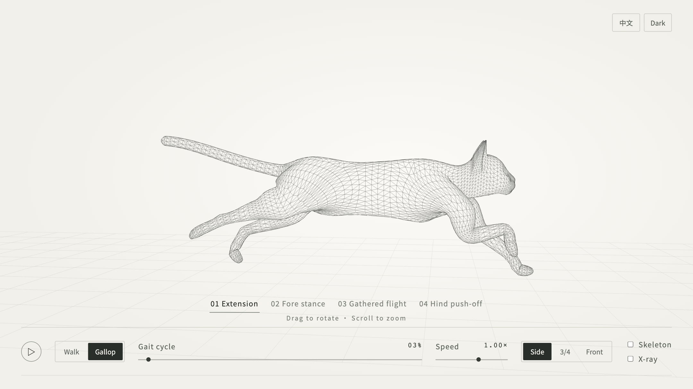
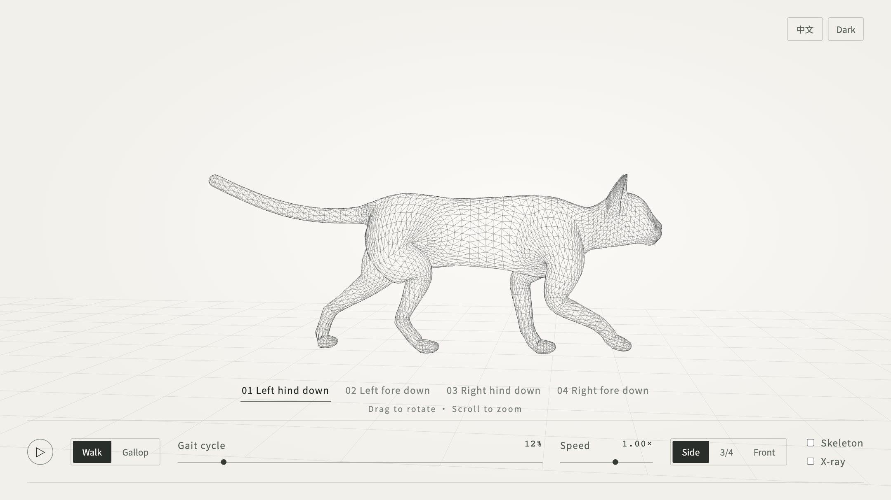

# Cat Gaits

[中文](README.md) · **English**





## Run

```bash
npm install
npm run dev     # local preview at http://127.0.0.1:5173
npm test        # checks the motion and the mesh
npm run build   # static build in dist/
```

## Controls

- **Gait**: switch between Walk and Gallop next to the play button. The key-pose buttons change to that gait's four poses.
- **View**: switch between side, 3/4 and front at the bottom. Drag to rotate, scroll to zoom.
- **Playback**:
  - Space plays or pauses; the left and right arrow keys step through the cycle.
  - Clicking a key pose or dragging the gait-cycle slider pauses there.
  - The speed slider sets the playback rate.
- **Display**: "Skeleton" shows the joints on their own; "X-ray" shows the lines hidden behind the body.
- **Top right**: switch between Chinese and English, and between light and dark mode. The page opens in Chinese and light mode and remembers your choice.

## Model

- **Geometry**:
  - One closed triangle mesh runs from the tail tip to the head, including the legs and both ears.
  - The upper arms and thighs join openings cut into the chest and waist, and the paws are continuous with the legs.
  - Limb cross-sections differ front to back, giving the elbow point, calf, Achilles tendon and heel.
  - The trunk is deep at the chest and narrow at the waist, and narrower than it is deep.
- **Head**:
  - Based on a short-haired black cat. The braincase, cheekbones, nose bridge, muzzle, chin, jaw and neck are blended into one solid, and the skin vertices are cast onto it (`src/head-shape.js`).
  - The ears are thin triangular shells growing from the crown, opening forward and outward.
- **Subdivision**:
  - The belly, thighs and head are refined across their triangles and placed on the smooth surface; the tail and lower legs are refined mainly along their length.
  - Topology and weights are built before playback and shared by the whole cycle.

## Motion

- **Footfalls**:
  - Each foot follows its own stance and swing path.
  - The two forefeet land 0.16 of a cycle apart, the two hind feet 0.10 apart.
  - When the hind legs are fully extended, the forelegs stay bent, tucked under the chin.
- **Ground contact**: planted feet move at ground speed. The swinging hind foot passes outside the forefoot on the same side.
- **From the front and behind**:
  - Paws land close to the midline.
  - The trunk rolls and shifts towards the loaded legs, and the loaded side's shoulder blade rises.
  - The head stays on the midline.
- **Tail**:
  - The tail only rises and falls in the vertical plane; it does not swing side to side.
  - The delay of the tail's motion grows from root to tip.
  - The tail is about six tenths of the head-and-body length.

## Walk

Set from published measurements of cats walking overground at about 0.6 m/s; the numbers and sources are in section 020 of the [research notes](references/RESEARCH.md).

- **Sequence**: left hind, left fore, right hind, right fore land in turn, a quarter stride apart. Two or three paws are always on the ground; there is no suspension.
- **Timing**: a 0.8 s step cycle, each paw planted for six tenths of it, and a stride of about 1.9 hip heights.
- **Placement**:
  - Left and right prints fall almost on one line.
  - The hind paw comes down beside the print the forepaw of the same side has just left, within about a third of a paw.
  - The forepaw lands a little ahead of the shoulder and stays down until it is well behind it, the leg almost straight.
- **Joints**: wrists and hocks follow the measured curves. They give as the paw takes weight, open to push off and fold early in the swing. Elbows and knees are solved from where the paw has to be.
- **Body**: the back is nearly level with the hips a little above the shoulders, and the legs stay bent. The hips sink about 3% with each step and the trunk bends slightly from side to side.
- **Tail and head**: the tail is carried just below level with an upturned end and only moves in the vertical plane; the head is held steady.
- The code is in `src/walk.js`; the spine, limb attachments, tail and head reuse the gallop's construction.

## References

- [Muybridge, *Cat galloping* (Plate 720)](https://www.nga.gov/artworks/220472-plate-number-720-cat-galloping)
- [Research notes](references/RESEARCH.md) (in Chinese): sources, plus the design and proportion comparisons for each version.

The gait is drawn after the photographs; it is not measured motion-capture data.
