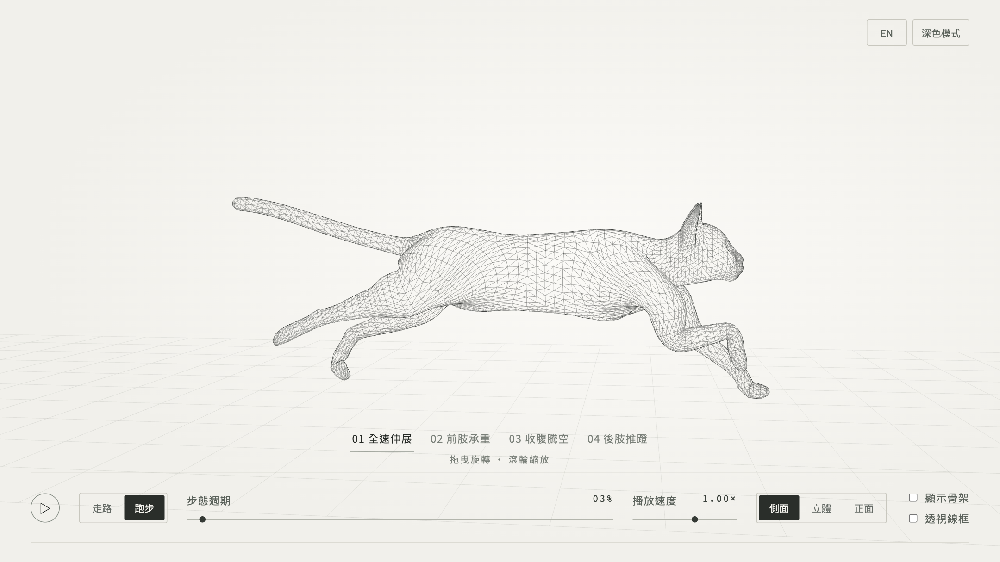
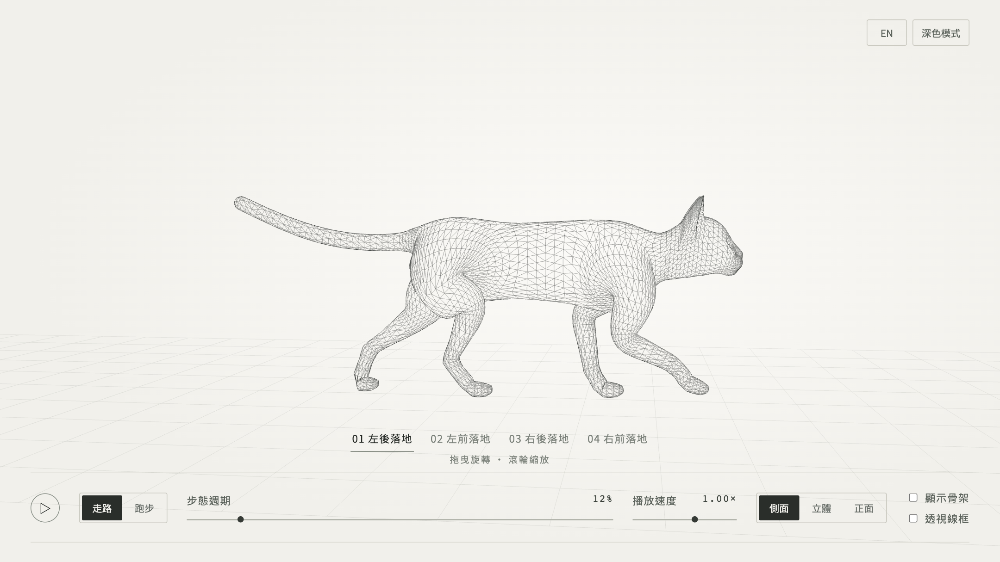

# 貓咪步態

[English](README.md) · **中文**





## 執行

```bash
npm install
npm run dev     # 本機預覽 http://127.0.0.1:5173
npm test        # 檢查動作與網格
npm run build   # 建置靜態版本到 dist/
```

## 操作

- **步態**：播放鍵旁可切換「走路」與「跑步」，關鍵姿態按鈕會跟著換成該步態的四個姿態。
- **視角**：下方可切換側面、立體、正面；拖曳旋轉，滾輪縮放。
- **播放**：空白鍵播放／暫停，左右方向鍵逐步移動。點關鍵姿態或拖動步態週期會暫停在該處，也可調整播放速度。
- **顯示**：「顯示骨架」可單獨查看關節，「透視線框」會顯示被遮住的線。
- **右上角**：切換中文／英文、日光／深色模式。預設為中文與日光模式，切換後會記住選擇。

## 模型

- **幾何**：從尾尖到頭、四肢與雙耳共用一張封閉三角網格。上臂和大腿接在胸腰挖出的開口上，腳掌與腿相連。四肢截面前後不對稱，做出肘尖、小腿肚、跟腱和跟骨。軀幹胸深腰收，寬度小於深度。
- **頭部**：以短毛黑貓為準。顱頂、顴骨、鼻樑、口吻、下巴、下顎與頸部幾個量體混成一個實體，皮膚頂點再投射到這個實體上（`src/head-shape.js`）。耳朵是從頭頂長出的薄殼三角耳，開口朝前外側。
- **細分**：腰腹、大腿與頭部沿三角面細分並取曲面位置；尾幹和小腿主要沿長度加密。拓撲與權重在播放前就建好，整個循環共用。

## 動作

- **步法**：
  - 四腳沿各自的支撐與回收路徑移動。
  - 兩隻前腳落地相隔週期的 0.16，兩隻後腳相隔 0.10。
  - 後腳完全伸直時，前腳仍彎著收在下巴下方。
- **與地面**：支撐腳與地面等速。後腳回收時，從同側前腳外側經過。
- **正面與背面**：
  - 腳掌落點靠近中線。
  - 軀幹隨承重的腳左右滾轉、側移，承重側的肩胛會上頂。
  - 頭部保持在中線上。
- **尾巴**：
  - 只在垂直面上起伏，不左右擺。
  - 尾根到尾尖的動作有逐漸增加的時間差。
  - 尾長約為頭身長的六成。

## 走路

依貓在平地行走（約 0.6 m/s）的實測資料設定，數字與來源見[研究筆記](references/RESEARCH.md)第 020 節。

- **步序**：左後、左前、右後、右前依序落地，各相隔四分之一步。任何時刻都有兩到三隻腳著地，沒有騰空。
- **節奏**：每步 0.8 秒，每隻腳六成時間著地，步幅約為髖高的 1.9 倍。
- **落點**：
  - 左右腳印幾乎在一直線上。
  - 後腳落在同側前腳剛離開的腳印旁，相差約三分之一個腳掌。
  - 前腳落在肩前不遠處，一路撐到肩後、腿幾乎伸直才離地。
- **關節**：腕與跗關節依實測曲線屈伸——著地初期讓一下、推蹬時打開、擺盪前段收起。肘和膝由腳掌位置解出。
- **身體**：背部接近水平、髖略高於肩，腿保持彎曲。髖每步下沉約 3%，軀幹隨步伐輕微左右側彎。
- **尾巴和頭**：尾巴略低於水平、尾端上翹，只在垂直面上起伏；頭部保持平穩。
- 程式在 `src/walk.js`，脊椎、肢體連接、尾巴與頭部沿用跑步的建構方式。

## 參考

- [Muybridge 的家貓疾馳連拍（Plate 720）](https://www.nga.gov/artworks/220472-plate-number-720-cat-galloping)
- [研究筆記](references/RESEARCH.md)：參考文獻，以及各版本的設計與比例對照。

這是參照連拍創作的跑姿，不是動作捕捉的量測結果。
